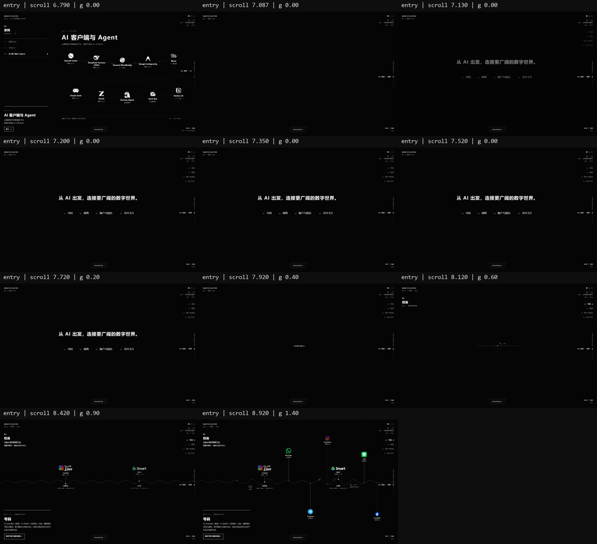
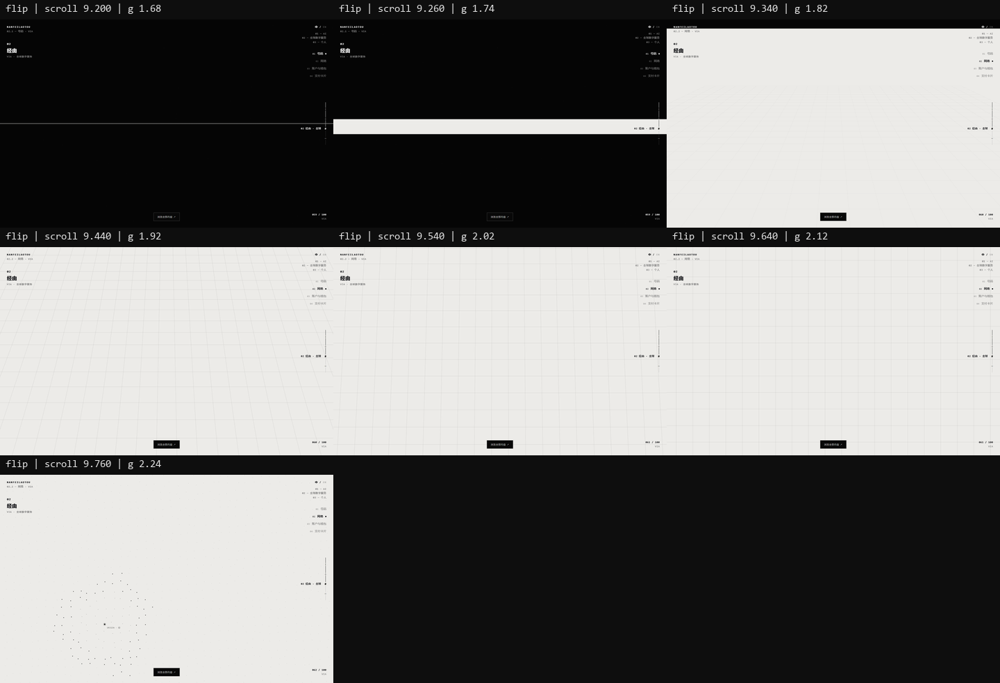
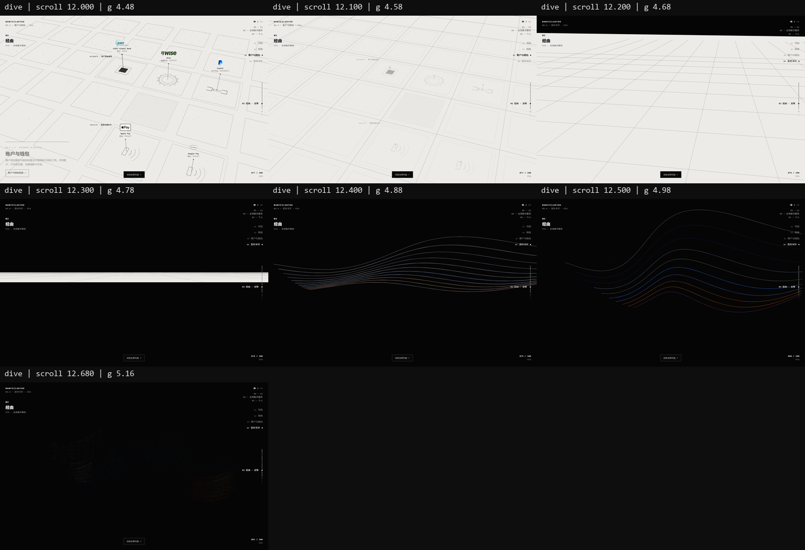
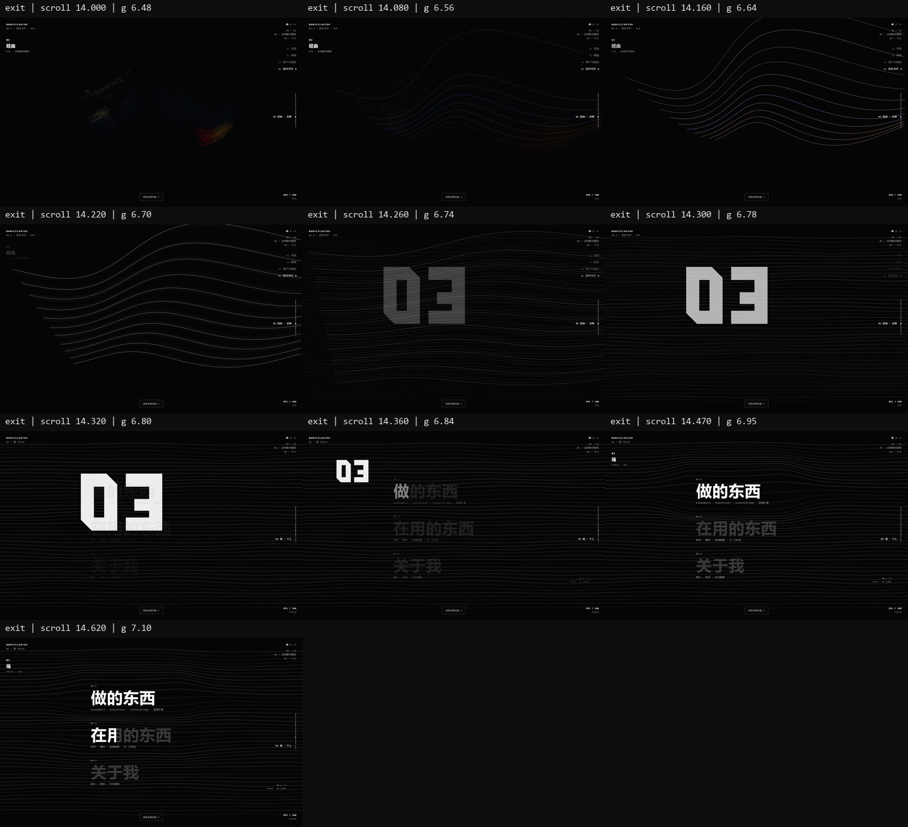

# Prototype 02 · AI + Global 正式整合

> V0.1 发布补充：唯一首页 HTML 现位于根 `index.html`，旧 prototype URL 兼容跳转到 `/`。本文保留本轮集成时的路径与测试语境；当前入口、资源隐私边界及回滚见 [发布记录](RELEASE-V0.1.0.md)。

2026-10-18，分支 `feat/home-ai-showcase-v2`。本轮将用户解压并已验收的本地 Opus Global World 接入现有首页，不合并 main、不改生产配置、根 `index.html` 的既有修改未触碰或提交。手机版竖屏精修按用户后续指示延后，仅做基本可访问性兼容。

## 预览与证据

```powershell
node scripts/serve.mjs
```

- 正式首页：[prototype/prototype-02.html](../prototype/prototype-02.html)，本地 `http://127.0.0.1:4173/prototype/prototype-02.html`。
- 独立 Opus：[global-world.html](../prototype/experiments/global-world.html)，本地 `http://127.0.0.1:4173/prototype/experiments/global-world.html`，仍可单独运行。
- [浏览器验收与前后对照](../tests/home-global/review.html)，本地 `http://127.0.0.1:4173/tests/home-global/review.html`。
- [约 44 秒实际操作录像](../tests/home-global/home-ai-global.webm)，包含三卡切换、出口和反向返回。与性能采样分开录制，无音频。
- [Opus 本地原始基线](global-world/opus-baseline/README.md)：五份原始源文件与说明的 SHA256、七张用户验收图及原沙盒脚本完整保存。

Global 卡面纹理需要同源 HTTP；`file://` 不作为本轮验收入口。没有新增构建步骤或前端框架。

## 滚动时间轴

唯一叙事源仍为 `scrollY / UNIT → sd → NF_TIMELINE.toScene(sd)`，主 RAF 仍在 `motion.js`。Opus 独立驱动在首页通过 `data-global-host="home"` 关闭；独立实验页继续使用自身驱动。卡片短时间弹簧 / 材质状态由同一帧传入的时间推进，叙事 q 始终优先。

下表均为**压缩后实际滚动屏数**，一屏 = 当前视口高度：

|部分|范围|稳定跳转点|
|---|---|---|
|Opening / 点到序列|0–2.34|0|
|模型生态|2.34–4.329899|3.419756|
|本地 AI|4.275–5.493689|5.28|
|AI 客户端与 Agent|5.425–7.087060|6.321111|
|AI → VIA 黑场桥接|7.087060–7.52|随滚动进入|
|Global / 经由 VIA|7.52–14.32|默认号码 8.92|
|Personal 预留|14.32–15.68|14.70|

AI 的七段压缩映射、三主题的起止 / 成形 / 停留 / 退出值逐项不变。Global 是实际 6.8 屏；Personal 从 legacy 9.74 而不是 9.44 开始，跳过已由 Global 完成的线场展开。因此总长为 **15.68**，不是机械地在原 10.58 上加 5.38 得到 15.96。

Global 局部进度 `g = sceneS − 8.95`，等价于这一段中的 `scrollS − 7.52`。`timeline.js` 同时提供 `globalProgress()`、`globalWorld.stops`、`personalLegacy()`，避免导航另算一套偏移。

|Global 领域|局部停点 g|全站滚动点|Hash|
|---|---|---|---|
|号码|1.40|8.92|`#global-number`|
|网络|3.30|10.82|`#global-network`|
|账户与钱包|4.25|11.77|`#global-accounts`|
|支付卡片|6.12|13.64|`#global-cards`|

`#global` / `#via` 进入号码稳定画面。翻面 g 1.70–2.32、下潜 g 4.50–5.16、三卡互动窗口 g 5.78–6.30、离场 g 6.48–6.80 都保持 Opus 关键帧。

## 接缝与图层

- **AI → VIA**：旧白色 Bridge 展开与旧四层 Global 均不再调用。桥接从 Agent 退出末端接入同一套 `sceneEntry`，文字“从 AI 出发，连接更广阔的数字世界。”与“号码 / 网络 / 账户与钱包 / 支付卡片”收拢到同一个点，再进入载波。没有黑→白→黑→白闪回。
- **背景**：`motion.js` 的 `setBackground()` 是首页唯一写入 `stage / html / body` 的入口。Global 通过 host 回调控制自己的黑→暖白→黑；独立页保留原背景逻辑。彩色品牌与卡片处于正常合成层，HUD 单独 difference。
- **VIA → Personal**：Global 11 流扩成 46 线；最后 g 6.72–6.80 将接近一致的线场交给 Personal。两边使用同一个 time 相位与 `#050505`；仅最后 0.08 屏做线场交接，处理两边 x 采样密度与章节标注差异。Personal 从已展开状态进入，不收回重展，其内部函数、三个入口与后续动作原样保留。
- Opening WebGL 与卡片 WebGL 分画布 / 分 Context；两套 Shader、混合状态互不清除。首页只保留一个主时钟，没有新增整页 scroll listener。实测窗口 listener 为 scroll 0、resize 1、keydown 1、Global pointermove 1。






## 四个板块与内容入口

站名和简介保持 `NANFEILAOTOU` / `AI、全球数字服务、个人项目与日常探索。`。第二章艺术名为 **经由 / VIA**，全站导航主题为 **全球数字服务**。入口说明为“从海外号码与网络工具，到数字账户、钱包与支付卡片。”

|领域|Opus 中文简介 / 内容边界|正式入口|
|---|---|---|
|号码|以 ClubSIM（香港）与 SMART（菲律宾）为例，理解境外号码与通讯、账号服务之间的关系；注册 / 验证条件以各平台官方说明为准。|海外号码与通信指南|
|网络|从客户端、代理节点到远程服务器，路由决定一次请求经由哪条路径抵达；四个客户端并列，不分先后。|网络工具与连接指南|
|账户与钱包|账户资金服务与钱包快捷支付是两类工具；并列不代表互通、充值或绑卡关系。|账户与钱包指南|
|支付卡片|海外实体卡、国内万事达借记卡、数字资产支付卡三种代表性场景；选择侧卡使数据流重组为新卡。|支付卡片指南|

仓库未发现对应已完成教程。本轮没有虚构教程，四个入口均打开可聚焦、可键盘关闭的内容索引，明确标记 **内容整理中**，包含品牌 / 卡片名称。`#guide-connectivity`、`#guide-network`、`#guide-accounts`、`#guide-cards` 可直接打开对应索引段落，不使用无效果的 `href="#"`。真实 URL 将来只需配置 [data/global-guides.js](../data/global-guides.js) 的 `url`。

## 三卡与生命周期

默认 StarryBlu 中央主卡、招行和 Bybit 在两侧。保留 Opus 的 64,000 点、双材质预乘混合、q .80 全点到位、.88–.98 高清接管、临界阻尼与最后选择优先控制。不是图片淡入替代；单独的原 `card-particle.* / card-surface.js` 实验完全不变。

- 主卡、侧卡、采样、后备均使用 StarryBlu 离线已处理副本；正式页不请求含原始号码 / 姓名的研究文件。
- 招行仍为 581×373，主卡最多 290.5 CSS px，DPR 2 下不超过 581 设备像素。
- 纹理在 Agent 已退出、Global 将出现时才初始化，不阻塞 Opening / AI 稳定画面；首卡就绪即可使用，延迟的目标在低 q 等待。Instagram 从官方 5000² 原图生成有来源记录的 512² 等比例派生图，仅首页采用；原图及独立基线不改。
- 卡片稳定时停止自身绘制，离开 Global 后不继续绘制。12 次重新进入保持单次初始化和纹理上传计数；Context 恢复后重建资源正常。
- 卡名按钮修正了整合容器中的 pointer-events 继承；键盘激活侧卡后，焦点转至新主卡可见的卡名按钮，不掉回 body。
- 指南入口修正了 HUD 链接颜色规则的优先级，悬停 / 键盘聚焦时保持白底黑字，避免入口文字消失。
- 对 Opus 卡适配器只有离屏 `busy=false` 状态修正；全部 Shader 与点轨迹未改。Global 模块新增可选 host 背景、入口文案、资源、焦点通知等接口，默认独立页行为保持不变。

键盘规则：Global 活跃时 `1–4` 为四个子领域；`Alt+0–3` 始终为全站章节。Global 外保留原数字键规则。Tab / Enter / Space 支持卡片；Esc 关闭详情 / 索引。滚轮和触摸能打断导航，不拦住正常滚动。刷新保存位置带新总长度版本，避免旧 10.58 屏的位置被误恢复到新 Global 中段。

## 实测结果

全部主要验收对象为整合后的 `prototype-02.html`，另单独验证独立 Global 能运行：

- AI 三桌面尺寸 × 五个固定画面共 15 次对照；排除因新总长更新的百分比 / 轨道，差异通道为 0（色阶阈值 2）。Opening 整帧原样，Shader、取样、鼠标排斥 / 恢复未退化。
- Opus 原始基线 → 当前独立版 → 整合版：四个停留点 × Canvas / WebGL 共 16 次比较，**最大逐通道差异 0**。比较的是视觉渲染层，首页 HUD 的必要调整另计。
- 21 个 AI 节点在三种桌面尺寸的显色、详情、Esc；Global 四阶段、指南索引、三卡点击、快速改选、晚期改选、正反滚动中断、键盘 / 焦点、Hash / Back / Forward、刷新、Resize 均通过。
- DPR 2、减少动态、实际强制 WebGL 不可用、慢纹理加载、切换中 Context lost / restored 均通过。正常 Console error / pageerror 与资源失败为 0。
- 20 秒稳定卡片停留新增绘制 0；12 次重新进入没有重复上传，最终复测手动 GC 后 JS heap 从 3,890,436 到 3,902,288 字节（约 +12KB），本次未观察到持续增长。不是对无限时长或驱动显存的保证。
- 390×844 仅验证无横向溢出、触摸选卡和索引可达；**竖屏审美与排版精修未展开**。

### 本机性能

Chromium **153.0.8010.12**，ANGLE / **NVIDIA RTX 4080 Laptop / D3D11**，未使用 SwiftShader 强制参数。各静态 / 环境阶段取预热后至少 180 个应用帧回调；另记录实时切卡。以下 rAF Hz 是浏览器应用回调采样率，不代表显示器最终呈现 FPS，也不能外推到低端 GPU。

|视口 / DPR|实时切卡耗时|切卡 CPU 平均 / p95|切卡 rAF Hz|采样长任务 ≥50ms|
|---|---|---|---|---|
|1920×1080 / 1|2545ms|1.554 / 3.9ms|237.3|0|
|1440×900 / 1|2608ms|1.322 / 3.5ms|238.9|0|
|1366×768 / 1|2545ms|1.262 / 2.6ms|240.0|0|
|1440×900 / 2|2602ms|2.505 / 7.4ms|201.2|0|

卡片纹理估算 **5,868,372 bytes**，点 / 面缓冲 **1,024,096 bytes**，不是驱动实际显存。完整阶段数据（含号码 / 网络 / 账户 / 稳定卡片）见 [performance-results.json](../tests/home-global/performance-results.json)。Opus 软件环境约 7fps 仅保留为历史记录，不用于本轮性能结论。

## 文件与提交

- 首页接入：[prototype-02.html](../prototype/prototype-02.html)、[motion.js](../prototype/motion.js)、[timeline.js](../prototype/timeline.js)。
- 模块适配：[global-home.js](../prototype/global-home.js)、[global-home.css](../prototype/global-home.css)、[global-guides.js](../data/global-guides.js)。
- Opus 接口兼容：[global-world.js](../prototype/experiments/global-world.js)、[global-card-adapter.js](../prototype/experiments/global-card-adapter.js)。独立 HTML / CSS 不变，原 Card Formation 文件不变。
- 小型资源派生：[Instagram 512](../assets/global/social/derived/instagram-512.png)、[原件 / 派生 SHA256](../assets/global/social/derived/manifest.json)。
- [测试脚本与全部结果](../tests/home-global/README.md)、[关键帧 / 录像审查](../tests/home-global/review.html)。`serve.mjs` 仅补充本地 WebM MIME，未改生产部署。
- Commit A：[`6c16a2a`](https://github.com/nanfeilaotou/personal-site/commit/6c16a2a)，完整保存本地 Opus 原型及验收材料。Commit B 随本报告保存正式集成、兼容修正与回归证据；最终 SHA 见本轮提交记录 / 交付回复。

## 待人工验收与明确未做的内容

桌面没有尚未通过的阻塞项，仍需用户审美验收入口节奏、两次翻面、三卡低 q 换色和出口线场。低 q 亮度与 11 条引导线保留 Opus 已验收效果，未另改 Shader 提亮。

四份真实教程尚未制作；Personal 仅保留原占位入口；手机竖屏下一轮统一优化；Safari / Firefox、真实 iOS / Android 与低端 GPU 本轮未验收。未修改 main、生产配置或根 `index.html`。
