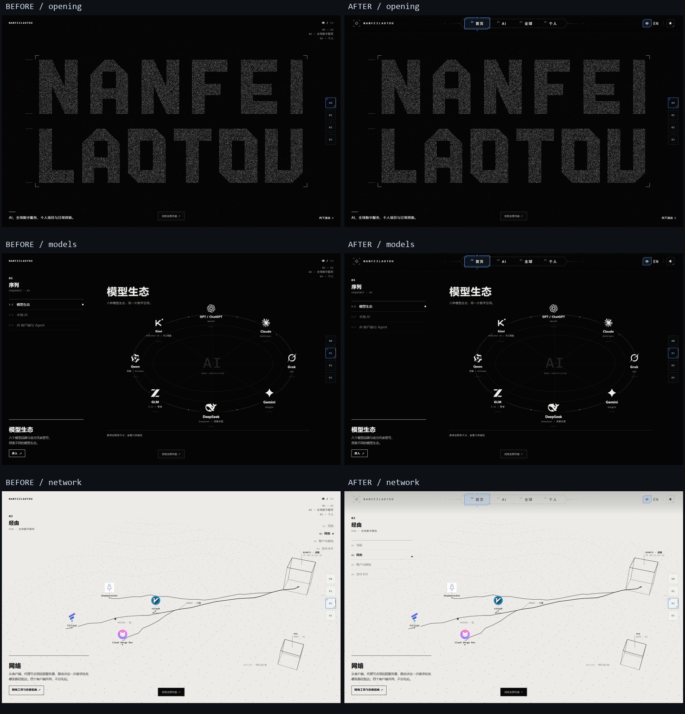

# LENS 顶部页面导航 · 正式首页集成

2026-10-18。以已发布 **V0.1.1 / 460d5d9** 为基线，保留上一轮的右侧 Module 轨道、UI 清理、Global→Personal 同线场接缝和快速返回。未合并旧实验分支，未回退至交付包说明中的 7b7e53b。

## 页面导航与章节导航分开

按用户最终指示，纠正 Opus 原型把顶栏映射到首页章节的逻辑：

|控件|职责|当前行为|
|---|---|---|
|LENS 顶栏|独立页面：首页 / AI / 全球 / 个人|整张滚动首页始终选中首页，包括滚动至 AI、Global、Personal 时|
|AI / 全球 / 个人顶栏入口|以后独立内容页面|本轮先预留，标记尚未开放；无假 Hash、不滚动、不创建空内容页面，不触发光闸|
|右侧 Module 轨道|首页内部 00–03 章节及局部进度|保留 V0.1.1 的四个目的地、颜色和行为|
|左侧 AI / Global 目录、数字键|当前首页内部子章节|继续沿用现有 NF_TIMELINE / STOP / navigate|

点击顶栏当前首页只做确认脉冲，不把首页滚动强制复位。末尾“回到起点”和右轨首页按钮保留上一轮约 0.33 秒的遮罩复位、原 Opening 重播。

**首页任何颜色均不随深浅主题改变**：包括 Opening、AI、Global 黑/暖白/黑、Personal、品牌详情、内容索引、右轨和手机菜单。主题控件仅保存供后续三个独立页面使用的偏好。顶栏随真实画面适配明暗，与主题偏好无关；太阳/月亮图标只表示所保存的偏好。

## 来源与代码

源自用户桌面 `nf-topnav-v2.zip` / `nf-topnav-v2/nav2`。压缩包与原始源码 SHA256 见 [SOURCE.json](../prototype/experiments/nav2/SOURCE.json)。保留 LENS 轨道、透镜、点阵、品牌预留位和菜单的视觉语言；原作者软件渲染的 24 项测试仅作为历史交付记录，不等同于本机测试。

- [正式根首页](https://personal-site-7xv.pages.dev/)，本地 `node scripts/serve.mjs`，默认 4173。
- [本轮前后对照](../tests/lens/review.html)，开发服务端口 4201。
- [独立模拟实验](../prototype/experiments/nav2/lab/index.html) / [iframe 叠加实验](../prototype/experiments/nav2/onsite/index.html)，仅作为原始研究保留；其章节跳转和主题示范不代表最终产品语义。
- 原设计在 `prototype/experiments/nav2/src/nf-topnav.js` / `.css` / `nf-i18n.js`；正式页面直接引用同一份，不复制第二套绘制源码。
- `prototype/topnav-home.js` 负责固定首页选中、未来页面占位、语言和菜单、真实背景上报。`topnav-home.css` 只调整宿主布局，无主题改色规则。

光闸功能作为可复用原组件保留，当前尚未开放的页面不调用它，也不借它控制首页章节。主滚动、导航停点和 15.68 屏时间轴未改，没有新增 scroll 监听器。顶栏的有限交互 RAF 只绘制 UI，静止后停止。

## 宿主适配

1. 删除旧 `#hTL` 品牌与 `#hTR` 右上重复入口，新品牌和页面主导航只出现一次。Global 四领域目录从右上移到左侧；手机保留原领域按钮位置。章节标题为 68px 顶栏留位，手机 58px。
2. 复用上轮真实 `NF_GLOBAL.surface` 和同一个多边形覆盖率函数，计算纸面对顶栏区域的覆盖程度。不读 body.on-white，不使用生产像素探针，不增加 WebGL Context。主题不参与场景颜色计算。
3. 主题保存为 `nf.theme`，但本首页的菜单面板同样依据真实场景决定颜色；主题切换仅更新偏好和按钮状态。后续独立页面可以读取此偏好，当前不虚构已上线的内容页。
4. 只有导航自身完整双语，正文明确位于 `lang="zh-CN"` 的 `#site-content`。切到 EN 时给出未翻译正文的提示，不改 hash、滚动位置或内容。
5. 手机菜单对整个 `#site-content` 设置 inert，关闭中的面板立即 inert，保留焦点陷阱和 Esc 归还焦点。不能只禁用原 difference HUD 而漏掉 Global / 品牌层。
6. 品牌弹层上沿避开新顶栏，限制高度并允许内部滚动；不改品牌节点坐标、图标颜色或数据。隐藏 Global 时显式约束其 intro，防止可见性覆盖逃逸父层。

原组件局部接口增加 `canNavigate` / 未开放提示、`artThemeIndependent` / 场景面板颜色、宿主取消及销毁保护；独立实验的原行为仍可运行。仅保留三张原交付代表图，未重复纳入全部逐帧图。

## 实测

实际硬件 Chromium / ANGLE / **NVIDIA GeForce RTX 4080 Laptop GPU**，非原作者 SwiftShader 帧率。

- [当前语义和交互](../tests/lens/results.json)：1920×1080、1440×900、1366×768，整个首页始终选中首页；其余三个入口点击和 Enter 不改 scroll/hash/history；右轨仍独立切章节；Global 1–4、Alt+0–3、Hash、Back/Forward、刷新、详情和语言偏好均验证。
- 深浅切换前后，对黑色 AI 和暖白 Global 的 Canvas、WebGL、背景、详情、索引、顶栏及菜单颜色逐项比较，保持一致。移动菜单也验证主题只保存偏好。
- 1180 / 980 / 761 布局无重叠；390 / 320 手机菜单、触摸、Tab、Esc、背景 inert 和减少动态效果验证。
- [画面比较](../tests/lens/regression-results.json)：与 V0.1.1 同时间、同尺寸的 Opening WebGL、AI 节点、Global Canvas、Personal 内容一致。[Opus 原型对照](../tests/lens/opus/opus-visual-results.json) 的 16 个结构/卡面比较像素一致。
- [完整首页功能](../tests/lens/full/local-results.json)：21 个 AI 条目 B 显色、三卡和快速重选、指南、历史、静态资源、安全卡面 URL。
- [DPR2 与后备](../tests/lens/fallback/fallback-results.json)：原开场鼠标排斥/恢复、卡面倾斜与低清卡预算、真实无 WebGL、减少动态、异步图片及指南直达。[上轮快捷返回](../tests/lens/return/return-results.json) 通过。
- [真实纸面覆盖率](../tests/lens/tone-results.json)：三种尺寸含 DPR2 共 60 样本，对实际绘制的纸面栅格比对，误差小于 4%。
- [性能记录](../tests/lens/performance-results.json)：1440×900，静止 1.4 秒顶栏重绘 **0 次**，rAF 间隔 p95 约 **4.3ms**；这些是本机回调/CPU 观察，不是 GPU timer-query 或跨设备帧率保证。
- 所有完成的本轮浏览器报告 Console / 失败资源为 0。对照截图通过同源 HTTP 浏览，代码和素材不依赖生产 Node 服务。

## 清理、发布与限制

按用户追加指示，原目录旧的未提交 `index.html` **已放弃**，不再沿用上一轮的保留策略。`D:\AI\personal-site` 切回 main，最终与 origin/main 同步；没有增加旧入口备份，也没有全仓 reset/clean 或删除真实素材、历史实验。开发在独立 worktree 进行。

沿用 Cloudflare Pages 与根静态目录，不改 DNS / 部署配置。发布后实际根地址验证记录在 [production.md](../tests/lens/production.md)。待后续：三个独立板块的页面内容、正式 Logo、正文英文、跨浏览器/实体手机和完整竖屏优化。
