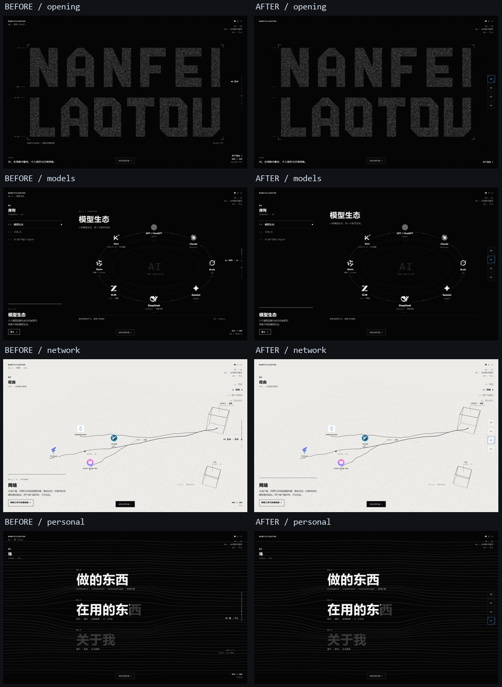
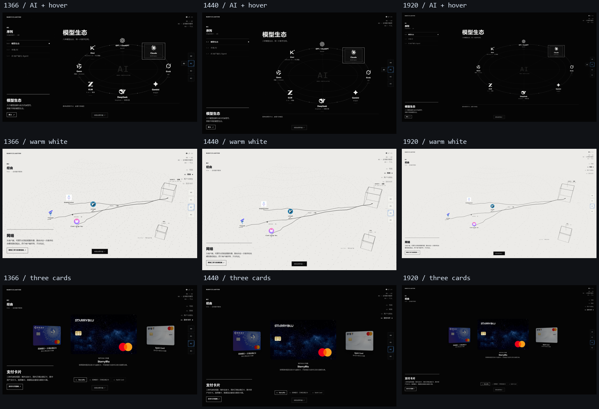
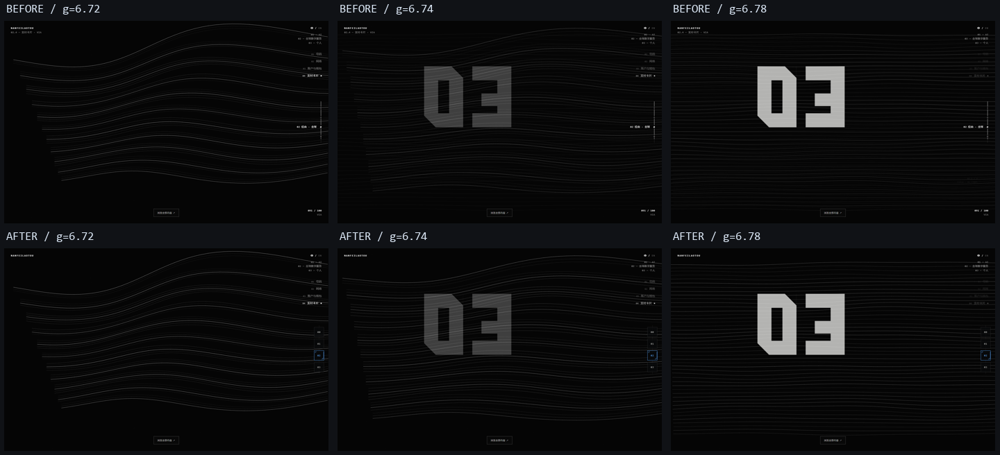

# V0.1.1 · 第一轮 UI 精修

基线 main / v0.1.0：`7b7e53b2be1610f18f112f37cd00b58fae4012a1`。独立 worktree 开发，原 `D:\AI\personal-site\index.html` 的 SHA256 保持 `BFC193B140D94B8669327F71A677D68F84DB19F573E262119C53894CDE4D1711`，不覆盖或暂存。未合并导航实验分支。

## UI 清理范围（实施前记录）

|元素|处理|原因|
|---|---|---|
|右下 `#prog` 全站百分比、`#pts` PTS / MODELS / VIA / FIELD|删除正式 DOM 与每帧更新|重复的全站状态，不帮助内容选择|
|左上 `#crumb` 章节面包屑|删除|左侧真实章节标题、子导航和新右侧选中项已表明位置；左上品牌保留|
|场景 `.eyebrow`、右侧 `.scene-foot` 数量标签、入口重复编号 `.entry .i` / `.gw-panel .i`|正式模式隐藏，debug 可查|去除重复编号与技术标签；标题、说明、操作提示和入口保留|
|Canvas 的字形单位、点数、LOCK 数字、Z 层数、COLLAPSE 计数、CH 编号、Local 尺寸和 FIELD 线数|仅 `?debug` 绘制文字|保留刻线、扫描、粒子、几何与转场，不把调试标注当内容|
|开场滚动提示|只在开场未滚动时出现|其它阶段已有导航及内容入口|
|左上品牌、右上原导航、AI / Global 子导航、真实品牌信息、指南和内容索引|保留|不出现导航真空，不删有效交互|
|Local 的权重精度说明、去噪步骤、Global 网络结构标注|保留|属于已验收场景的内容与视觉语义，不是重复全站计数器|
|实验控制台、FPS / 状态探针|保留在实验或 `?debug`|开发验收仍需使用，不作为正式页面常驻 UI|

## 实施记录

### 右侧 Module 章节导航

只选择性参考实验提交 `af647c8` 的 B 边框语言和多边形覆盖率算法，没有合并实验分支，也没有引入新顶部导航。原左上品牌和右上导航保持原样。

`prototype/rail.js` / `rail.css` 将现有 `#rail` 改为四个 44px 竖向节点，复用原 `data-go`、`STOP`、`navigate()`、`NF_TIMELINE`。默认显示编号，悬停或键盘聚焦展开名称；选中节点右缘仅显示本章节进度。方向键 / Home / End 在四个按钮间移动焦点，Enter / Space 使用原导航。没有新增 RAF 或 scroll 控制器。

轨道位于普通色彩图层，不受原 HUD difference 影响。Global 新增只读 `NF_GLOBAL.surface`，由原相机、裁剪和平面投影给出实际纸面多边形及底色。每个按钮分别计算覆盖率，使用 45% / 55% 滞回切换黑场电光蓝 `#5AA9FF` 与暖白场深蓝 `#1E63C6`；不用 `body.on-white`、读屏像素或近似时间阈值。51 个翻面采样逐个按钮与实际绘制纸面的栅格遮罩比对，覆盖率误差小于 4%。

品牌详情层高于轨道，打开详情时隐藏展开名称；三个桌面尺寸验证无卡片按钮、指南或子导航遮挡。手机宽度 ≤760px 隐藏新轨道，保留旧顶部入口与 Global 子导航。减少动态效果时取消轨道 CSS 过渡。

### 02→03 接缝：几何问题与性能分开处理

基线的最后 0.08 屏同时混合了仍在扩展的 Global 线场和已经完全展开的 Personal 线场。两者相位相同，但 spread 进度不同：g=6.72 时同索引线条在三个横向位置的平均 Y 差 **63.34px**，最大约 162px；到 g=6.8 才趋于一致。它表现为重影和运动停顿，不是测试机器上明确的掉帧。

最小修复仅在原 underlay 区间，将 **当帧 `gw-cv`** 复制到主 Canvas，Personal 只绘制原章节标题；既有淡出完成后继续原 `sceneField()`。因此过渡中始终是同一套正在运动的线场，不提前插入另一个完成态。Global 的线场源码、相机、时间相位及 Personal 内部线条公式均保持原样；时间轴文件逐字未改。

实际硬件：Chromium 153 / ANGLE Direct3D11 / **NVIDIA GeForce RTX 4080 Laptop GPU**，1440×900。以相同 2.4 秒原生滚动驱动分别正向、反向采样，两个版本 rAF 间隔 p95 均约 **4.3ms**（约 240Hz 回调节奏）。不能把它解读为所有设备的保证帧率或 GPU 完成时间。

|接缝子区间 CPU 提交耗时均值|之前正向 / 反向|之后正向 / 反向|
|---|---|---|
|Personal 绘制调用|0.706 / 1.077ms|0.0106 / 0.0091ms（仅标题）|
|当帧 Canvas 复制|无|0.0485 / 0.0364ms|

区间为内部 sceneS 15.67–15.75，各方向 66 次采样。instrumentation 只注入测试响应，生产无探针；CPU 数据不含异步 GPU 执行。前后完整样本见 [before-seam.json](../tests/ui-v011/before-seam.json)、[after-seam.json](../tests/ui-v011/after-seam.json)。

### 快速回到起点

远距离 Home / 回到起点使用主帧循环中的 **140ms 深黑遮罩 → 遮罩完全覆盖时原子定位 0 → 180ms 揭开**，不再反向经过 15.68 屏。同步清零原生 scrollY、缓动位置、速度、鼠标状态和开场时间，然后重播已有 Opening。测试完成时间 **327.5ms**；全程 native scrollY 只有末尾或 0，第一次到 0 时遮罩为完全不透明，原 WebGL program 对象未重建。

重复点击只创建一次返回；Esc、滚轮、触摸和其它导航可以中止；遮罩期间刷新恢复起点。减少动态效果直接定位到已成形字样。近距离导航沿用原缓动，未添加新粒子或 Shader。[返回实测](../tests/ui-v011/return-results.json)。

## 回归与截图

- [可浏览的前后对照页](../tests/ui-v011/review.html)，本地启动 `node scripts/serve.mjs` 后打开 `/tests/ui-v011/review.html`。
- 三种桌面分辨率 **1920×1080 / 1440×900 / 1366×768**；手机 390×844 基本导航；DPR 2 卡面、减少动态效果、真实禁用 WebGL 后备。
- 同一 GPU / 固定时间比较：Opening WebGL 像素、AI 21 条目坐标、四个 Global 稳定阶段 Canvas / 卡面像素、Personal 内容与基线一致。去除的 UI 文字不计入应保持相同的几何层；10 个场景全页前后图另外保存。
- 原 Opus / 当前独立原型 / 正式首页 16 个 Canvas 与 WebGL 比较：**changedChannels=0**。WebGL 截图须在同一 JS 任务内渲染并读出，防止未 preserve 的 drawing buffer 被合成器清空；修正的是测试读取时机，没有放宽容差。
- 21 条目悬停显色、详情鼠标转入、固定 / Esc / Tab；四章节右轨、全局键盘与 Global 1–4；Hash、Back/Forward、刷新、Resize；三卡重复切换、快速点击、滚动中断、异步贴图均通过现有功能测试。
- 新轨道独立纸面覆盖率、黑白翻面、局部章节进度、浮层优先级和返回遮罩另有针对测试。所有本次浏览器报告 Console / 资源错误 **0**。
- 静态断言保护原 Shader / 采样 / drawGL、整个时间轴、AI 数据与运动、Global 相机和核心场景、卡片实验和素材。原目录未提交 index 另有 SHA256 保护。

测试脚本与原始 JSON 位于 [tests/ui-v011](../tests/ui-v011/)。复跑说明见该目录 README。旧 V0.1.0 截图没有被覆盖；现有测试新增输出目录参数，当前运行记录归到本轮目录。

限制：本轮使用实际硬件加速的无头 Chromium，并非手持手机或跨浏览器实测；手机完整竖屏美术优化、新顶部导航仍待后续。本轮未发现未解决的功能阻断或明显几何回归，细节审美仍可通过对照页复核。

## 提交、生产与回滚

生产仍为 [Cloudflare Pages 根地址](https://personal-site-7xv.pages.dev/)，沿用现有 main → 静态根目录发布，不新增构建服务。UI 清理、右轨、接缝、快速返回分别独立提交，便于按项 revert。main 以 fast-forward 接收本次基于正式版的提交，导航实验分支不合并。

本地改动范围：根正式入口、`prototype/motion.js`、`prototype/experiments/global-world.js` 的只读接口、新 `ui.css` / `rail.js` / `rail.css` / `return.css`、测试与本报告。全部品牌、卡面、Card Formation Shader、正式 AI / Global / Personal 主体和顶部栏保留。

原目录 `D:\AI\personal-site` 仍留在功能实验分支，` M index.html` 不被覆盖、暂存或提交。改动仅在独立干净 worktree 完成。发布后记录见 [生产验证](../tests/ui-v011/production.md)。如需整体回滚，以 `v0.1.0` 为内容基线创建回退提交（保留历史），或在 Cloudflare 回滚到已验证的 V0.1.0 部署；不对共享 main 使用 force / reset。
