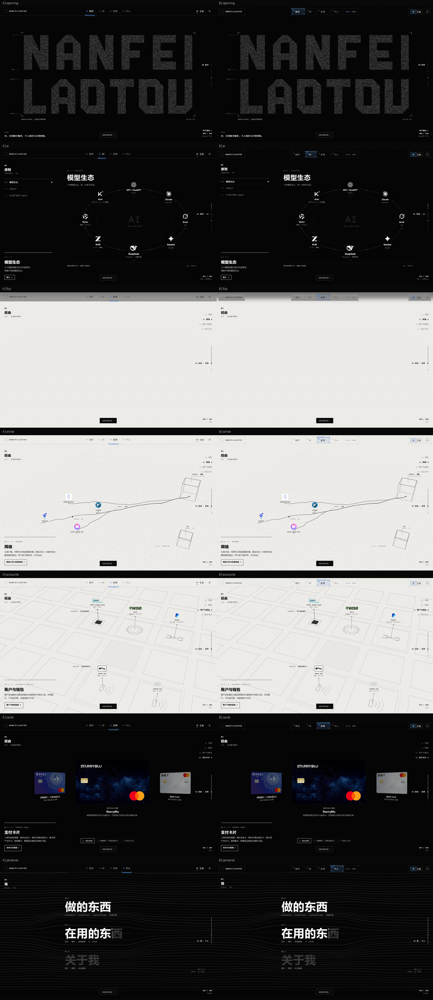
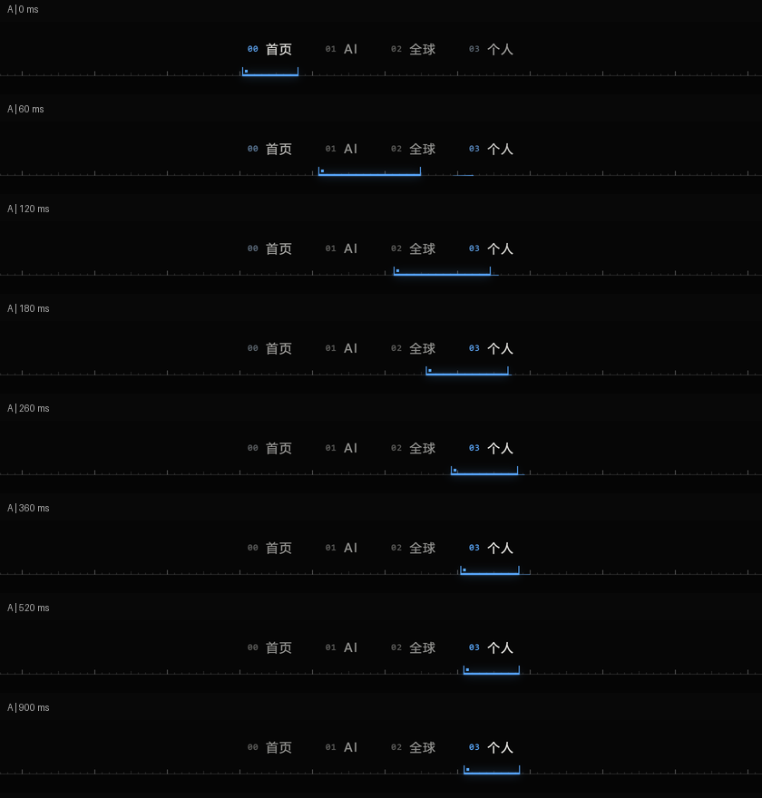
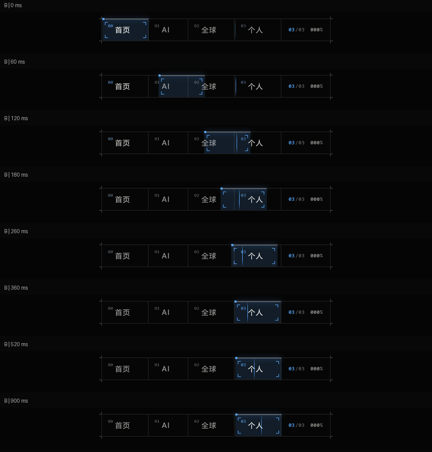

# 导航 A/B 原型 · Windows 真机验收

2026-10-18。用户提供 `nf-nav-prototype.zip`，已放入项目 `prototype/experiments/nav/`。真实首页宿主是已发布 main `7b7e53b2be1610f18f112f37cd00b58fae4012a1` 的独立工作区，原目录中未提交的 `index.html` 不参与叠加预览，哈希保持 `BFC193B140D94B8669327F71A677D68F84DB19F573E262119C53894CDE4D1711`。

本轮只交付实验，不替换正式导航、不推送 main、不改线上部署、Shader、时间轴、Global 绘制或 Personal。提交目标为当前功能分支 `feat/home-ai-showcase-v2`；最终提交号见本轮交付回复 / Git 记录。

## 预览

在项目根运行 `pwsh -File scripts/preview-nav.ps1`。脚本只读寻找当前 origin/main 对应的已检出工作区；如没有，传入 `-SitePath` 指向干净主线工作区，不覆盖用户目录。

- A：<http://127.0.0.1:4190/nav/onsite/index.html?scheme=a>
- B：<http://127.0.0.1:4190/nav/onsite/index.html?scheme=b>
- 模拟实验 / 控制台：<http://127.0.0.1:4190/nav/lab/index.html>
- [本机 A/B 截图对照](index.html)：<http://127.0.0.1:4190/nav/review/index.html>
- 原始交接：[README.md](../README.md)；[本项目 Windows 说明](../LOCAL-PREVIEW.md)。

保留原包的 78 个文件及原作者截图 / Linux 脚本，输入哈希清单在 `tests/nav-review/input-manifest.json`。原脚本写死 Linux Chromium / SwiftShader 的测试结果不作为本机硬件性能。

## 本轮修正

测试复现：在真实首页区域滚轮中断跳转后，首页已停止，但父页面新导航仍锁定 Personal 目标，短时间显示错误选中项。修正仅涉及两个实验文件：

- `src/nf-nav.js`：公开已有的取消目标锁方法 `cancelNavigation`；弹簧参数、绘制和样式不改。
- `onsite/index.html`：转接 iframe 的 wheel / touch / 导航按键和旧导航点击，取消父页面目标锁；焦点在新顶栏时转发主线数字键与 Alt+数字导航；菜单打开时让背景 iframe inert，关闭恢复。重复加载先解绑旧文档，BFCache 保留时不误清理。

旧 `#hTL / #hTR` 和章节栏位移仍仅由叠加页注入样式，HTTP 提供的 main 文件及主线工作区均不变。静态检查对全部 78 个输入文件核对 SHA256，除上述两份实验文件外保持原始字节；主线工作区无差异。

## 功能测试

[完整结果](results.json) 的 group 为 all、completed 为 true，Console / pageerror / 加载失败均为 0。

- A/B × 1920×1080、1440×900、1366×768：Opening、AI、Global 翻面中间态、暖白、账户、三卡、Personal，选中项与稳定背景 tone 正确，无横向溢出。
- 直接操作真实 main 的 Claude 节点详情 / Esc 与 Bybit 粒子切卡；本轮未重新调研或改写 21 个 AI 条目，主体模块沿用已验收 main。
- AI → Global 点击抵达原稳定停点；iframe 滚轮可中断、目标锁及时取消；父导航聚焦后的数字键、Global 子领域、Alt+3 与 0 正常。
- 独立实验页：导航中英文、正文缺失英文时的 ZH 角标、可读面板锚点保持、信息面板 / 内容页深浅主题、方向键焦点。
- A/B × 390 / 360 / 320：菜单打开 / 关闭、语言 / 主题选择、Tab 焦点约束、Esc 返回菜单按钮、选择项目关闭、iframe inert 恢复、菜单与根文档无横向溢出。
- 系统减少动态、DPR 2、桌面↔手机 Resize 通过。手机整站竖屏精修仍按原计划延期。

Windows 启动脚本实际启动过另一端口，并通过 HTTP 将其 `/index.html` 与 origin/main 的 HTML 对比一致，同时确认 `/nav/` 指向本地实验。

## 运动与截图

[60Hz 轨迹原始数据](trajectory-results.json)：A/B 从首页到 Personal 及反向，单目标完整位移最大过冲和回退均小于 0.1 CSS px，没有出现途经标签的选中闪现。另保留 DPR 2 下 0 / 60 / 120 / 180 / 260 / 360 / 520 / 900ms 的真实截图。





## 硬件实测

Chromium **153.0.8010.12**，**ANGLE / NVIDIA GeForce RTX 4080 Laptop / D3D11**，没有 SwiftShader 参数。性能与功能截图分开执行，对原 main、A、B 分别预热并采样 AI、暖白、稳定卡片各 360 个回调，另实际运行一次卡片重组。

|1440×900 / DPR 1|AI 导航回调 CPU 均值|AI 同步回调 CPU 均值|实时切卡耗时|切卡 rAF Hz|
|---|---:|---:|---:|---:|
|原 main|无新增导航|无新增同步|2609ms|215.4|
|A 刻度|0.029ms|0.016ms|2610ms|217.3|
|B 舱窗|0.035ms|0.096ms|2611ms|209.7|

三种页面在稳定 AI / 暖白 / 卡片阶段采样 rAF 约 240Hz；上述采样内 ≥50ms 长任务为 0。rAF Hz 是应用回调节奏，不等于显示器最终呈现 FPS；CPU 是带仪表的 JS / Canvas 提交计时，不是 GPU 执行耗时，也不能外推到其他机器。没有据此断言 A 必然比 B 更快。完整阶段数据、p95 和最大值见 [性能原始记录](performance-results.json)。

## 明确未完成的集成项

- 叠加页 Global 顶栏 tone 仍沿用原作者的关键帧近似；没有用 body.on-white 代替，也没有修改 global-world.js。正式接入时再增加只读纸面覆盖率回调，不能声称当前已逐帧精确。
- 真实 main 正文仍是中文，主题按钮没有把真实 AI / Global / Personal 面板主题化。实验页提供了主题和 ZH 回退示例，叠加页如实提示首页正文尚无英文；这是原型接口边界。
- Logo 仍为原有细线框预留位，未虚构正式 Logo。未给 main 注入新的永久控件。
- 本机仅测试 Chromium，手机为浏览器尺寸 / 触摸仿真，尚非真实 iOS / Android 验收。没有开始手机整站视觉重构。

推荐继续以 A 作为长期导航候选，B 保留对照；方案定稿后另行正式接入，当前 GitHub 功能分支保存可运行原型和证据。

## 复测

沿用当前项目的 Playwright / Chromium 与 Python Pillow 环境，Node 需要能解析 Playwright（本机使用 Codex 缓存运行时 NODE_PATH）。先启动预览服务器，再执行：

```powershell
node tests/nav-review/static.cjs
node tests/nav-review/check.cjs
node tests/nav-review/trajectory.cjs
# 性能单独运行，不并行录屏或其它 GPU 测试
node tests/nav-review/performance.cjs
python tests/nav-review/build-review.py
```

可选 `NAV_TEST_GROUP=desktop|input|lab|mobile|access` 做单项复测，完整结果由未指定分组的运行生成。GitHub 里可直接查看本报告与 PNG；可交互原型需要本地 Python 预览服务，不是新增生产部署。
