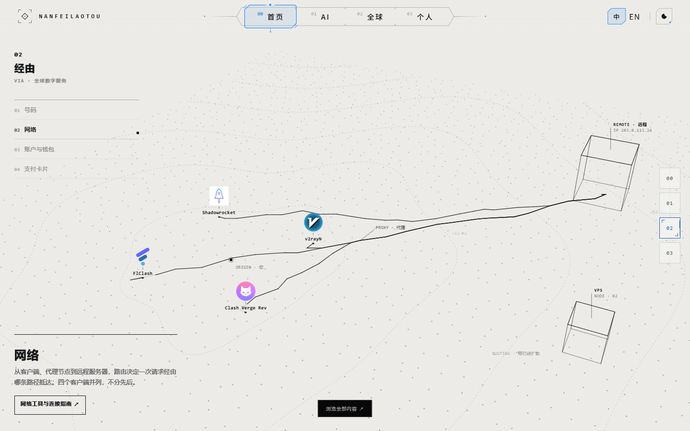
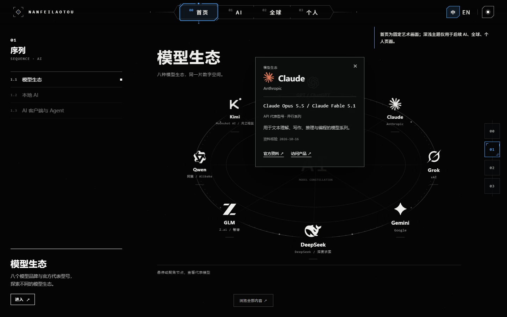

# LENS production verification

Verified 2026-10-18 against the actual root **https://personal-site-7xv.pages.dev/**.

Application revision: [`64f8b2d144bbad2f3153a378606217ba65c8c2b3`](https://github.com/nanfeilaotou/personal-site/commit/64f8b2d144bbad2f3153a378606217ba65c8c2b3), following imported component `234f9ab`. Subsequent evidence-only commits do not change production HTML/CSS/JS or assets.

- Existing main Cloudflare Pages integration succeeded: [production snapshot](https://7a514659.personal-site-7xv.pages.dev/) / build `7a514659-6fd7-48da-8a66-06bf41df86e2`; [successful check](cloudflare-production.json).
- [Root byte verification](deployment-results.json): `/` plus 16 runtime files returned HTTP 200 and matched the checked-in Git blobs, including the LENS component, homepage adapter, timeline, card adapter and AI data.
- [Online browser report](online/results.json): completed=true, Console errors=0, failed resources=0. All three desktop sizes preserve **Home selected throughout the entire scrolling homepage**. The other page entries do not change scroll, hash or history. The rail, Global 1–4 / Alt+0–3, Back/Forward and reload still navigate homepage chapters independently.
- Online dark / light preference comparisons kept the black AI and white Global artwork, background, details, catalog, topbar and menu colours unchanged. Chinese body fallback, language persistence, mobile 390/320 focus trap / Escape / inert, intermediate widths and reduced motion passed.
- [Local visual regression](regression-results.json), [full 21-brand/card suite](full/local-results.json), [DPR2/fallback](fallback/fallback-results.json), [Opus unchanged rendering](opus/opus-visual-results.json), [quick return](return/return-results.json) and [60 paper-coverage samples](tone-results.json) remain available.

The old top-right HUD is removed. Global's four-domain directory moves left. The entire site at `/` is the homepage; **AI / Global / Personal in the topbar are future separate pages**, currently explicitly unavailable. No empty tutorial/content pages were fabricated. Theme preferences are saved for those future pages, not applied to any homepage surface.

Per the user's updated cleanup instruction, the original uncommitted `D:\AI\personal-site\index.html` was deliberately discarded. That checkout is now clean main and synchronized to origin/main; no extra old-index copy was created. Development occurred in a separate worktree. No deployment configuration, Shader, sampling trajectory, card algorithm, AI data or timeline changed.

Future work: the three independent page bodies and real URLs, final Logo, body translations, physical-phone and cross-browser validation. The historical lab/onsite experiments retain their original design demonstrations; the formal host adapter follows the user's corrected page-navigation semantics.
