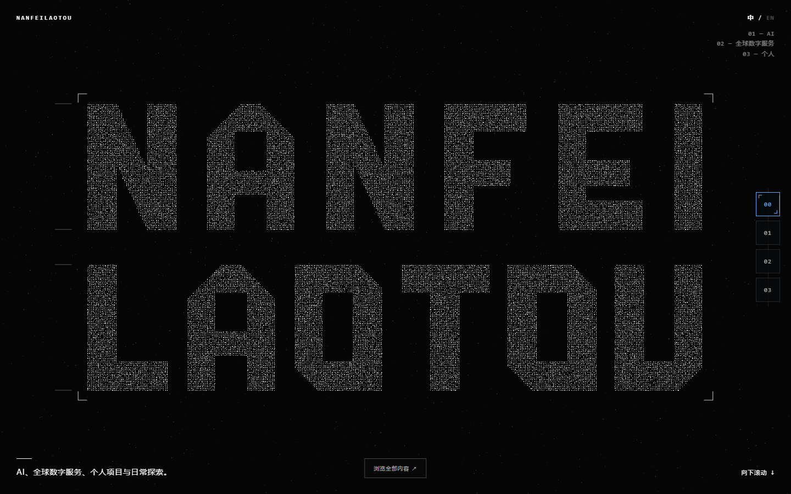
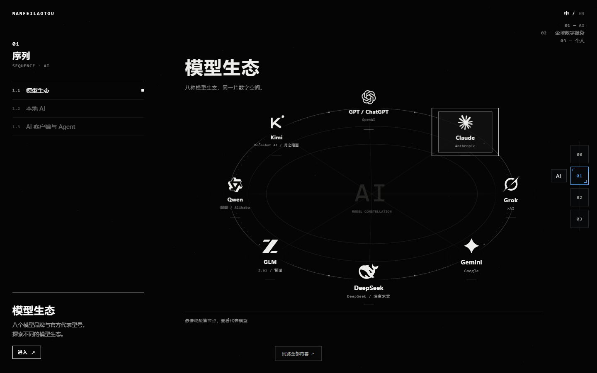

# V0.1.1 production verification

Verified 2026-10-18 on the actual production root: **https://personal-site-7xv.pages.dev/**. Local baseline is v0.1.0 / 7b7e53b. See [review](review.html) and [full UI report](../../docs/UI-V0.1.1.md).

Application revision: [`a369225299673477d40850f70527c54d0871c195`](https://github.com/nanfeilaotou/personal-site/commit/a369225299673477d40850f70527c54d0871c195). Subsequent evidence-only commits do not change HTML/CSS/JS, imagery, shaders or deployment configuration.

- Existing Cloudflare Pages Git integration deployed main successfully: [production snapshot](https://1b2a2fbc.personal-site-7xv.pages.dev/) / build `1b2a2fbc-cf1f-45cf-9376-e2355c36f6f2`; [successful check](cloudflare-production-build.json). The release work branch also has an independent preview; it is not used as proof of production.
- [Root byte verification](deployment-results.json): HTTP 200 at `/`; root HTML plus 11 runtime files exactly match Git blobs. The public root was tested, not only the snapshot or `/prototype/` alias.
- [Full online functional suite](online-functional/online-results.json): completed=true, errors=0, failed resources=0. Three desktop resolutions, 21 AI entries, all four Global stops, three real cards / rapid reselect, guide dialogs, Personal, keyboard, root hash / Back / Forward / reload, old bookmarks, actual no-WebGL, reduced motion, mobile touch and offline-safe StarryBlu legacy URL.
- [Online right-rail suite](online-rail/rail-results.json): completed=true, errors=0, failed resources=0. Three desktop sizes, exact per-node paper coverage, local chapter progress, keyboard focus movement, four destinations, detail/card/guide priority and mobile fallback navigation.
- [Online return suite](online-rail/return-results.json): completed=true, errors=0, failed resources=0. Cover/reset/reveal completed in **328.1ms**, original WebGL program retained; repeat click, Esc, wheel, refresh and reduced motion passed.

Implementation commits are independently revertible:

|Commit|Scope|
|---|---|
|`fac137f`|Production UI cleanup|
|`c2eed08`|Module rail and read-only paper geometry|
|`96fb13c`|Same-frame Global / Personal line-field handoff|
|`9e158f7`|Short return mask and original opening replay|
|`d5a4f6c`|Read the small surface getter without building debug snapshots|
|`a369225`|Local regression, measurements and screenshots|

The navigation experiment branch `feat/home-ai-showcase-v2` remains at `af647c8`; it was not merged. Main only receives descendants of the accepted formal baseline, via fast-forward. The original `D:\AI\personal-site` still has only ` M index.html`, with the pre-task SHA256 unchanged and nothing staged. The development worktree is separate.

Release tag: `v0.1.1`. For rollback, revert the relevant scoped commit (assess dependencies) or create a content-restoration commit from `v0.1.0`; preserve shared Git history. Cloudflare also retains the already verified V0.1.0 deployment.

Remaining scope: full mobile portrait visual design, cross-browser / physical-phone performance, and the future Opus top navigation. No new blocker was found in the tested Chromium hardware path.
